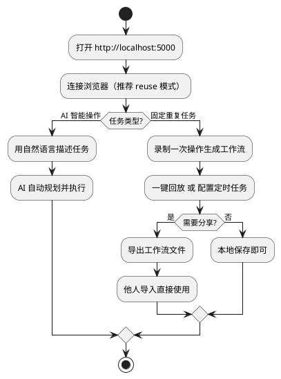

# OperatingBrowser

AI 驱动的浏览器与桌面自动化工具。通过自然语言下达指令，AI 自动完成网页操作；也支持将人工操作录制为工作流，一键回放、定时执行，并可分享给他人导入使用。

## 功能特性

### AI 智能操作
- 自然语言驱动：直接用中文描述任务（如"打开某网站并搜索关键词"），AI 自动规划并执行浏览器操作
- 兼容 OpenAI 及任何兼容 API（DeepSeek、通义千问等）

### 三种浏览器连接模式
- `reuse` 复用模式：接管你正在使用的 Chrome，保留所有登录态和 Cookie
- `standalone` 独立模式：启动独立 Chrome 实例，空白 Profile，不影响已有浏览器
- `builtin` 内置模式：使用 Playwright 内置 Chromium

### 操作录制与工作流
- 手动录制：在浏览器中正常操作，自动捕获点击、输入、导航等行为并转换为可回放步骤
- 多标签页支持：录制时可识别新开页签、切回页签、关闭页签，回放时自动处理
- 一键回放：保存的工作流可随时重新执行
- 导出分享：工作流可导出为文件，他人导入即可直接使用（含定时任务配置）

### 定时任务
- 多种触发方式：固定间隔、每天定时、Cron 表达式
- 自动启停：可选触发时自动启动浏览器、执行完成后自动关闭浏览器
- 持久化：定时任务随服务重启自动恢复，随工作流导出/导入自动重建

### 桌面自动化
- 支持 PyAutoGUI / pywinauto 桌面元素操作，覆盖浏览器之外的本地应用场景

## 快速开始

### 环境要求

- Windows（桌面自动化功能依赖 Windows API）
- Python 3.11+
- [uv](https://docs.astral.sh/uv/) 包管理器（启动脚本会自动安装）
- Chrome 浏览器

### 一键启动（Windows）

```bat
双击 start.bat
```

脚本会自动完成：
1. 安装 uv（如未安装）
2. 从 `.env.example` 创建 `.env` 并打开记事本，填入你的 API Key
3. 安装依赖（`uv sync`）
4. 安装 Playwright Chromium
5. 启动服务并打开 `http://localhost:5000`

### 手动启动

```bash
# 1. 安装依赖
uv sync

# 2. 安装 Playwright 浏览器
uv run playwright install chromium

# 3. 配置环境变量
copy .env.example .env
# 编辑 .env，填入 OPENAI_API_KEY 等配置

# 4. 启动
uv run python app.py
```

### 复用已有浏览器（推荐）

`reuse` 模式可以保留你的登录态，需要先以调试端口启动 Chrome：

```bash
chrome.exe --remote-debugging-port=9222
```

然后在页面连接设置中选择「复用已有浏览器」即可。日常使用建议保持此模式，AI 操作的就是你平时登录好的浏览器。

## 配置说明

编辑 `.env` 文件（首次可从 `.env.example` 复制）：

| 变量 | 说明 | 默认值 |
|------|------|--------|
| `OPENAI_API_KEY` | AI API 密钥 | 无（必填） |
| `OPENAI_BASE_URL` | API 地址，支持任意兼容 API | `https://api.openai.com/v1` |
| `OPENAI_MODEL` | 模型名 | `gpt-4o` |
| `BROWSER_MODE` | 浏览器连接模式：`reuse` / `standalone` / `builtin` | `reuse` |
| `CDP_URL` | 复用模式下的 CDP 连接地址 | `http://127.0.0.1:9222` |
| `HEADLESS` | 是否无头模式 | `false` |
| `HOST` / `PORT` | 服务监听地址和端口 | `0.0.0.0` / `5000` |

## 项目结构

```
OperatingBrowser/
├── app.py               # Flask 主服务与 API 路由
├── browser_engine.py    # 浏览器自动化引擎（基于 Playwright）
├── desktop_engine.py    # 桌面自动化引擎（PyAutoGUI / pywinauto）
├── manual_recorder.py   # 手动操作录制器
├── workflow_manager.py  # 工作流保存、回放、导出/导入与定时任务
├── ai_agent.py          # AI 智能体（任务规划与执行）
├── templates/           # Web 前端界面
├── start.bat / stop.bat # Windows 启动/停止脚本
└── .env.example         # 环境变量示例
```

## 使用流程



## 常见问题

**Q: AI 操作报连接失败？**
先确认 `.env` 中 API Key 和 Base URL 正确；使用兼容 API 时注意模型名是否支持。

**Q: 复用模式连不上浏览器？**
Chrome 必须以 `--remote-debugging-port=9222` 启动才能被接管，先完全退出 Chrome 再用该参数重新打开。

**Q: 录制回放时某一步找不到元素？**
页面内容可能已变化，可在工作流编辑中调整对应步骤的选择器，或重新录制该步骤。

## 许可证

仅供学习与个人使用。
